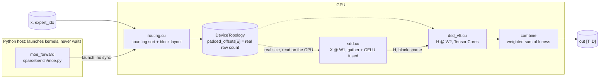

# SparseBench

Custom CUDA kernels for a full Mixture-of-Experts (MoE) layer, from routing to output, written as block-sparse matrix multiplies (the MegaBlocks formulation). **The whole layer runs without a single host sync.**

On A100, for MoE with many small experts, the layer is **1.4x faster than a MegaBlocks-style pipeline, 1.7x faster than grouped GEMM and 1.8x faster than ScatterMoE** (forward pass). For a few large experts (Mixtral-like), grouped GEMM wins by about 1.2x, and this README explains why.

> **Status:** A100 work is done: kernels, 1,378 tests, sanitizer-clean, benchmarked against four real implementations. Next is the H100 port ([TODO](#todo)). All numbers: one Colab A100-SXM4-40GB, BF16, forward pass, 4096 tokens, top-2.

---

## Contents

- [The problem](#the-problem)
- [Architecture](#architecture)
- [Results](#results)
- [The kernel, one bottleneck at a time](#the-kernel-one-bottleneck-at-a-time)
- [What didn't win, and why](#what-didnt-win-and-why)
- [How it's tested](#how-its-tested)
- [Limits](#limits)
- [Running it](#running-it)
- [Repo layout](#repo-layout)
- [TODO](#todo)
- [References](#references)

---

## The problem

In an MoE layer, a router sends each token to its top-k experts (here k = 2). Each expert is a small two-layer MLP. Every expert gets a different, unpredictable number of tokens. That makes two common approaches slow:

| Approach | Problem |
|---|---|
| Pad every expert to the busiest one, then one batched matmul | Skewed routing wastes most of the math on padding. Here: 6.4x slower than ours on the second matmul under Zipf routing. |
| One matmul per expert | Many tiny matmuls, each too small to fill the GPU, plus the CPU has to learn the counts first. Here: 8x slower than ours with 64 experts. |

**Block-sparse instead** (MegaBlocks, 2022): sort token copies by expert, pad each expert only up to a multiple of 128 rows, and treat the whole layer as one matrix multiply that skips every block that would be zero. That's one big launch per matmul, with work split into equal 128-row pieces no matter how skewed the routing is.

## Architecture



- **The host only launches.** It never reads a size back from the GPU.
- **`DeviceTopology` is the hand-off.** Routing writes it. Both matmuls read the real row count from it.
- **The extension is one pybind11 module** (`csrc/bindings.cpp`): routing, SDD, DSD.

| Step | File | What it does |
|---|---|---|
| Routing | `csrc/routing.cu` | Counting sort of token copies by expert, on the GPU. Each warp ranks same-expert lanes with `__match_any_sync`, so the order is stable without atomics. Builds the block-sparse layout (which 128 × 128 blocks are non-zero). |
| SDD | `csrc/sdd.cu` | First matmul, `X @ W1`, written straight into block-sparse form. It **gathers tokens inside the load** (no sorted copy of `X`), **zero-fills padding rows** with `cp.async`'s zero-fill (no memory reads), and **fuses GELU** into the output. |
| DSD | `csrc/dsd_v5.cu` | Second matmul, `H @ W2`, block-sparse × dense. Five versions, below. |
| Combine | `sparsebench/moe.py` | Each token's k outputs, weighted. |

**No host sync, and why it matters.** The number of padded rows is only known after routing, on the GPU. Asking the CPU to read it stalls the pipeline. Instead, every buffer is sized for the worst case (`T·k + E·127` rows), and kernels read the real size from GPU memory. Row blocks past the real end exit immediately. A test captures the whole layer in a CUDA graph and replays it with new tokens and new routing. Graph capture fails on any host sync, so that test is the proof.

## Results

### Whole layer, end to end

Routing + both matmuls + GELU + combine, all inside the timer. Each pipeline is checked against an fp32 reference before it's timed, and runs in its own process. Time in ms, lower is better. Source: `bench/bench_moe.py` → `bench/results_moe.md`.

| | Fine-grained (64 experts) | Mixtral-like (8 experts) | Host sync? |
|---|---:|---:|---|
| **Ours** | **1.85** | 12.1 | no |
| MegaBlocks-style (`stk`) | 2.60 | 13.0 | yes |
| Grouped GEMM (`torch._grouped_mm`) | 3.17 | **9.8** | no |
| ScatterMoE | 3.40 ‡ | 19.0 ‡ | yes |
| Per-expert loop | 15.0 | 12.8 | yes |

Shapes: fine-grained = D 1024, F 4096, E 64. Mixtral-like = D 4096, F 14336, E 8. Uniform routing shown. Zipf-skewed routing gives the same picture. ‡ From a later session than the other rows; ratios vs ours from that session.

### Where the win comes from

Per-stage GPU time, fine-grained, ms. Source: `bench/bench_breakdown.py` → `bench/results_breakdown.md`.

| Stage | Ours | MegaBlocks-style | Grouped GEMM | ScatterMoE |
|---|---:|---:|---:|---:|
| Routing / sort | 0.04 | 0.13 + sync | 0.23 | 0.49 + sync |
| Padded copy of X | fused | 0.21 | - | fused |
| Layout metadata | - | 0.63 * | - | - |
| 1st matmul | 0.75 (+ GELU) | 0.73 | 1.16 | 1.35 |
| GELU | fused | 0.16 | 0.10 | 0.10 |
| 2nd matmul | 0.68 | 0.66 | 1.50 | 1.50 |
| Combine | 0.21 | 0.22 | 0.27 | fused |
| **Total** | **1.67** | 2.74 | 3.24 | 3.44 |

- **vs MegaBlocks-style:** the matmuls tie. The whole gap is around them: no padded copy, fused GELU, and the layout built on the GPU with no sync.
- \* That 0.63 ms is our PyTorch rebuild of MegaBlocks' layout. MegaBlocks builds it with its own CUDA kernels, which are likely faster. Even with that stage removed entirely, ours is still 1.3x faster.
- **vs grouped GEMM and ScatterMoE:** here the matmuls themselves win, 1.43 ms vs 2.7–2.9. Equal 128-row blocks keep the GPU busy, where per-expert GEMMs on small experts don't.

### One matmul at a time

The second matmul alone (DSD), time in ms. Source: `bench/bench_baselines.py` → `bench/results_baselines.md`.

| | Fine-grained | Mixtral-like |
|---|---:|---:|
| **Ours (v5)** | 0.63 | 5.5–6.4 |
| MegaBlocks `stk` (Triton) | 0.63–0.65 | 4.9 |
| CUTLASS grouped GEMM | 1.18 | 4.0 |
| `torch._grouped_mm` | 1.19 | 4.0 |
| ScatterMoE | 1.55 | 7.1–8.4 |

Ours and MegaBlocks' Triton kernel are within 3% on fine-grained. Both are ~1.9x faster than grouped GEMM there.

## The kernel, one bottleneck at a time

Each DSD version fixes the one bottleneck `ncu` measured in the version before. Old versions stay callable (`dsd(..., version=N)`), so this table is reproducible from one script. Mixtral-like shape. Sources: `bench/bench_dsd.py`, `bench/results_ncu.md`.

| Version | Change | What `ncu` showed | TFLOPS |
|---|---|---|---:|
| v1 | Tensor Cores (`mma.sync` PTX), plain loads | Tensor Cores 14% busy. Top stall: waiting on global memory. | 42 |
| v2 | 3-stage `cp.async` pipeline: load the next tiles during math | Global-memory stall 10.7 → 0.3. New top stall: shared-memory queue full, from 145M bank conflicts. | 62 |
| v3 | XOR swizzle + `ldmatrix` / `ldmatrix.trans` | Bank conflicts 145M → ~9k. Now memory-bandwidth bound (78%). | 137 |
| v4 | Row-block-first tile order; dead row blocks exit early | Bytes read from GPU memory halved (row blocks of one expert share weights in L2). | 147 |
| v5 | 128 × 256 tiles, K step 64, 64 × 64 warp tiles, 144 KB shared memory | Tensor Cores 54% → 64% busy. Top stall is now "Tensor Cores busy" (the good kind). 242 registers, 0 spills. | 174 |

v5's inner loop (`csrc/tile_gemm_v5.cuh`) is shared with SDD, so both matmuls get every fix.

## What didn't win, and why

Measured, and written down, because these are the interesting parts.

| Idea | Result | Why |
|---|---|---|
| **Few large experts (Mixtral-like)** | Grouped GEMM ~1.2x faster | With 8 experts of ~1,000 tokens each, it's just 8 big dense matmuls: nothing sparse to exploit. On a plain dense matmul of this size cuBLAS reaches ~78% of the A100's peak (245 of 312 TFLOPS); our DSD reaches ~56% (174). Our padding adds ~7%. The right engineering call is to send this case to grouped GEMM. |
| **Block size 64 instead of 128** | Slower everywhere | It halves padding under skew (40% → 21%), but each smaller tile does too little math per byte loaded. |
| **2 vs 3 pipeline stages** | No difference | `ncu`: registers set how many thread blocks fit per SM (2 in v4 with either stage count), so the extra shared memory of a third stage never changes how much work runs at once. |
| **Token rounding** (SonicMoE, 2026) | 1.28–1.30x where padding is 35%; 1.07–1.11x in the regime the paper says keeps model quality | Helps grouped GEMM just as much. Our PyTorch rounding step costs 0.6+ ms, about what it saves. See `bench/results_token_rounding.md`. |
| **Persistent kernel with a work queue** | Not built | In this layout every real row block has the same work, so there's no imbalance for a queue to fix. Skewed routing costs padding, not imbalance. |

## How it's tested

| What | How |
|---|---|
| Correctness | 1,378 tests. Every kernel is compared to a plain PyTorch reference (`sparsebench/reference.py`), on hand-made nasty routings: empty experts, one overloaded expert, Zipf, 1 token. Asymmetric inputs, so a transposed fragment can't hide. |
| Exactness | Routing output matches the PyTorch version bit for bit. |
| Memory / races | `compute-sanitizer` memcheck + racecheck: 0 errors on every version as it landed. |
| No host sync | CUDA graph capture of the full layer, replayed with new data. |
| Before every push | Python emulation of each kernel's index math (fragment layouts, swizzle, pipeline schedule) against a plain matmul, with a bank-conflict counter and a negative control that proves the check catches a planted bug. |
| Baselines | Every competitor is checked against the same fp32 reference before it's timed, and gets its fastest correct configuration. |

## Limits

- **A100 only so far.** No `wgmma` / TMA yet (that's the H100 phase).
- **Forward pass only.** ScatterMoE and SonicMoE report their wins for training (forward + backward) and memory, which this doesn't measure.
- **Block size 128, D a multiple of 256, F a multiple of 256, BF16.** Other shapes get a clear error.
- **Noise:** absolute times moved up to ~20% between Colab sessions. Compare rows within one table, not across runs.
- The MegaBlocks-style pipeline uses MegaBlocks' Triton kernels (`stk`) with our routing and a PyTorch rebuild of its layout, not the full MegaBlocks library.

## Running it

Needs an NVIDIA GPU with compute capability 8.0+ (A100 / H100) and PyTorch with CUDA. `notebooks/colab_runner.ipynb` does all of the below on Colab.

```bash
TORCH_CUDA_ARCH_LIST="8.0" pip install --no-build-isolation -e ".[test]"
python -m pytest -q                  # 1,378 tests (GPU)
python bench/bench_moe.py            # whole layer vs baselines
python bench/bench_breakdown.py      # per-stage times
python bench/bench_dsd.py            # DSD v1 -> v5
bash bench/ncu.sh 5 mixtral          # hardware counters for one kernel
```

Optional baselines: `pip install --no-deps stanford-stk grouped_gemm` and ScatterMoE from git (pinned commit in the notebook). The pure-PyTorch parts (`reference.py`, `topology.py`, `token_rounding.py`) and their tests run on CPU too.

## Repo layout

```
csrc/
  routing.cu          GPU routing: counting sort + block-sparse layout
  sdd.cu              1st matmul: fused gather + GELU, written as blocks
  dsd_v1.cu … v5.cu   2nd matmul, one bottleneck fixed per version
  tile_gemm_v5.cuh    shared inner loop (cp.async ring, swizzle, ldmatrix, mma)
  mma.cuh             PTX wrappers: mma.sync, cp.async, ldmatrix
sparsebench/
  moe.py              the full layer
  reference.py        PyTorch ground truth
  topology.py         PyTorch version of the layout (tests check routing.cu against it)
  baselines.py        adapters for every competitor, on the same data
  token_rounding.py   SonicMoE's router-side padding fix
bench/                every benchmark + results_*.md with the recorded numbers
tests/                1,378 tests
notebooks/            Colab runner
```

## TODO

- [ ] **H100 port** (`sm_90a`): `wgmma` + TMA + `mbarrier`, on SJSU's HPC. Same tests and benchmarks, results in their own column, plus a full sanitizer run over every kernel version. Add SonicMoE and DeepGEMM as baselines there (both target Hopper).
- [x] Explain the Mixtral-like gap ([What didn't win](#what-didnt-win-and-why), `bench/results_breakdown.md`).
- [x] Per-stage time breakdown (`bench/results_breakdown.md`).
- [x] Baselines: MegaBlocks `stk`, CUTLASS + torch grouped GEMM, ScatterMoE.
- [x] Token rounding experiment (`bench/results_token_rounding.md`).

## References

- Gale et al., *MegaBlocks: Efficient Sparse Training with Mixture-of-Experts*, 2022. [arXiv:2211.15841](https://arxiv.org/abs/2211.15841)
- Tan et al., *Scattered Mixture-of-Experts Implementation* (ScatterMoE), 2024. [arXiv:2403.08245](https://arxiv.org/abs/2403.08245)
- Guo et al., *SonicMoE: Accelerating MoE with IO and Tile-aware Optimizations*, ICLR 2026. [arXiv:2512.14080](https://arxiv.org/abs/2512.14080)
- NVIDIA PTX ISA: `mma.sync`, `ldmatrix`, `cp.async` fragment layouts.
